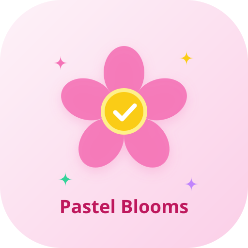

# 🌸 Pastel Blooms To-Do & Productivity Garden

A complete, polished, aesthetic pastel to-do list web application built with **Python (Flask)**, a zero-framework responsive single-page frontend (HTML5, CSS3, vanilla JavaScript), a local SQLite database, and **Streamlit** cloud publishing capability.



---

## ✨ Feature Highlights

### 🎨 Look and Themes
- **Default Theme**: Delicate shades of soft pastel pink and cloud white.
- **Switchable Pastel Presets**:
  - 🌸 **Cherry Blossom** (Pink)
  - 🌼 **Sunny Daisy** (Yellow)
  - 💙 **Forget-Me-Not** (Blue)
  - 🍀 **Lucky Clover** (Green)
  - 💜 **Sweet Lavender** (Lavender)
  - 🌙 **Pastel Midnight** (Dark Mode with glowing pastels)
- **Custom Accent Color**: Color picker to customize accents on top of presets.
- **Cute Font Choices**:
  - Rounded (*Quicksand*)
  - Handwritten (*Patrick Hand*)
  - Bubbly (*Fredoka*)
- **Layout Density**: Compact vs. Comfortable spacing.
- **Custom Checkbox Shapes**: ✿ Flower, ♥ Heart, ★ Star.
- **Washi Tape Task Cards**: Cards styled like stationery paper with translucent washi tape strips at the top.
- **Theme Seasons**: Spring (sakura petals), Summer (sunflower glow), Autumn (maple leaves), Winter (snowflakes).
- **Custom Wallpaper**: Upload your own background image with a soft frosted glass overlay for readability.
- **Floating Particles**: Background floating petals, leaves, or snowflakes with a toggle.

### 🌼 Interactive Flower Cursors
- **5 Custom SVG Flower Cursors** tailored to each theme.
- **Blooming Effect**: Flower petals expand and bloom when hovering over buttons, cards, and interactive elements.
- **Petal Trail**: Subtle particle trail of tiny fading petals following cursor movements.
- **Touch Device Support**: Spawns cute petal sparkles at tap coordinates on mobile and tablets.
- **Cursor Picker**: Choose your favorite cursor independent of your chosen theme.

### 📋 Core Task Management
- **Add, Edit, Delete** with drag-and-drop reordering.
- **Due Date & Time** with cute highlight ribbons for overdue tasks.
- **Priority Colored Dots**: High (Rose), Medium (Apricot), Low (Mint).
- **Notes & Descriptions**: Markdown-friendly notes on each task.
- **Subtasks / Checklists**: Nested checklists with an animated progress bar.
- **Categories & Tags**: Personal, School, Home, Work, Self-Care, or create your own custom categories.
- **Multiple Lists**: Today, This Week, Someday, Secret Diary (locked list), and custom lists.
- **Pin / Star**: Pin high-priority tasks to the top.
- **Satisfying Completion**: Strikethrough animation, confetti / petal sparkle bursts, and soft Web Audio crystal chimes (with mute toggle).
- **Search & Filters**: Instant search (`/`), filter by All, Active, Completed, or Archived.
- **Undo System**: Accidental delete restore with toast notification and `Ctrl+Z`.
- **Recurring Tasks**: Daily, weekly, monthly recurrence auto-creates the next task.
- **Snooze**: Postpone tasks to tomorrow or next week with one click.
- **Bulk Actions**: Select multiple tasks to complete, snooze, or delete together.
- **Task Dependencies ("Do this before that")**: Blocked tasks are visually locked with a padlock badge until prerequisite tasks are finished.
- **Time Estimates**: Set estimated minutes per task and view daily totals.
- **Time Tracking**: Live stopwatch on every card to track exact seconds spent.
- **Quick-Drop Templates**: 1-click addition of *Morning Routine*, *Study Session*, *Grocery Run*, or *Self-Care Day*.

### 🧠 Smart Quick-Add
- Natural language parser recognizes:
  - Relative dates: `today`, `tomorrow`, `tonight`, `next week`, `in 2 hours`, weekdays (`monday`...`sunday`)
  - Times: `5pm`, `17:00`, `9:30am`, `noon`, `midnight`
  - Priority: `!high`, `!urgent`, `!med`, `!low`
  - Tags: `#family`, `#school`, `#work`
  - Estimates: `~30m`, `~1h`, `~45m`
- Live interactive preview chips appear below the input as you type!

### 📅 Planning, Insights & Habits
- **Today View**: Auto-collects what is due today and overdue.
- **Monthly Planner & Calendar**: Visual calendar grid; drag any task onto a calendar day to reschedule its due date.
- **Daily Habit Tracker**: Track daily habits with circular check buttons and streak counters.
- **Upcoming Countdowns**: Countdown cards for birthdays, exams, and vacations.
- **Eat The Frog**: Prominently highlights the day's hardest task (highest priority & longest estimate).
- **Stats & Weekly Review**: Completion rate, total time tracked, and 7-day completion chart.
- **Print / Save as PDF**: Clean, print-ready CSS checklist layout.

### 🐰 Mascot & Blooming Garden
- **Animated Companion Mascot**: Cute SVG bunny or flower buddy that smiles when tasks are finished, cheers on streaks, sleeps when idle, and gives sweet motivational tips on click.
- **Blooming Garden Meadow**: Every completed task grows a new flower in your virtual garden! Persistent across days, with flower varieties matching your task categories.
- **Sticker Rewards Book**: Unlock achievement stickers at streak milestones.
- **Zen Focus Mode**: Fullscreen distraction-free mode featuring one task and the Pomodoro timer.
- **Daily Quotes**: Bundled collection of sweet, encouraging quotes.

### 🔒 Privacy & Security
- **Password Lock Screen**: Salted password hashing via Werkzeug (`generate_password_hash`).
- **First-run password setup** with password hints.
- **Inactivity Auto-Lock** (configurable timeout).
- **Lock on Tab Switch** and **Panic Lock** (`Alt+L` / `Esc`).
- **Secret Locked Lists**: Protect private lists (e.g. Secret Diary) with extra security.
- **Lockout Delay**: Progressive lockout on repeated incorrect attempts.

### 📄 AI PDF Summarization
- Upload lecture slides, articles, or syllabi.
- Extracts readable text server-side using `pypdf`.
- Generates summary and actionable to-do items using the Anthropic Claude 3.5 API (or smart heuristic fallback if no API key is configured).
- 1-click "Add Extracted Tasks to My List"!

### 📱 PWA & Offline Support
- Installable Web App via `manifest.json` and `sw.js` service worker.
- Responsive for mobile, tablet, and desktop.
- Accessible ARIA labels and `prefers-reduced-motion` support.

---

## 🚀 Local Run Instructions

### 1. Install Dependencies
```bash
pip install -r requirements.txt
```

### 2. Configure Environment (Optional)
Copy `.env.example` to `.env`:
```bash
cp .env.example .env
```
Add your optional `ANTHROPIC_API_KEY` for deep AI PDF summaries or SMTP credentials for email digests.

### 3. Run the App
```bash
python app.py
```
Open your browser at **`http://127.0.0.1:5000`** 🌸

---

## 🌐 Publish to GitHub and Deploy on Streamlit Cloud

To host and share your cute To-Do list publicly on the web for free using **Streamlit Community Cloud**:

### Step 1: Initialize Git and Push to GitHub
```bash
git init
git add .
git commit -m "🌸 Initial commit of Cute Pastel To-Do Web App"
git branch -M main
git remote add origin https://github.com/<your-username>/<your-repo-name>.git
git push -u origin main
```

### Step 2: Deploy on Streamlit Community Cloud
1. Go to [share.streamlit.io](https://share.streamlit.io) and sign in with your GitHub account.
2. Click **"New app"**.
3. Select your repository: `<your-username>/<your-repo-name>`.
4. Branch: `main`.
5. Main file path: `streamlit_app.py`.
6. (Optional) In *Advanced Settings*, add secrets such as `ANTHROPIC_API_KEY`.
7. Click **"Deploy!"**.

🎉 Your public live app URL will be:
```
https://<your-username>-<your-repo-name>.streamlit.app
```

---

## 📁 Project Structure

```
├── app.py                  # Flask backend with SQLite DB, REST APIs, AI PDF extractor
├── streamlit_app.py        # Streamlit deployment wrapper for GitHub Cloud hosting
├── requirements.txt        # Python dependencies
├── .env.example            # Environment variables template
├── todo.db                 # SQLite database (auto-created on first run)
├── templates/
│   ├── index.html          # Main single-page application
│   └── share.html          # Read-only public list view
├── static/
│   ├── css/
│   │   ├── themes.css      # Pastel themes, dark mode, seasons, wallpapers
│   │   ├── style.css       # Main styles, washi tape cards, layouts, fonts
│   │   └── animations.css  # Petal sparkles, mascot, strikethrough, confetti
│   ├── js/
│   │   ├── app.js          # Main frontend controller & state sync
│   │   ├── sound.js        # Web Audio API crystal chimes & bells
│   │   ├── flower-cursor.js# Custom SVG flower cursors & petal trail
│   │   ├── smart-parser.js # Natural language quick-add parser
│   │   ├── mascot.js       # Animated SVG companion buddy
│   │   └── garden.js       # Blooming flower garden meadow
│   ├── icons/
│   │   └── icon.svg        # Cute app icon
│   ├── manifest.json       # PWA Web App Manifest
│   └── sw.js               # Service Worker for offline PWA
└── README.md               # Documentation & deployment guide
```

Enjoy your peaceful, blooming productivity! 🌸🐰✨
